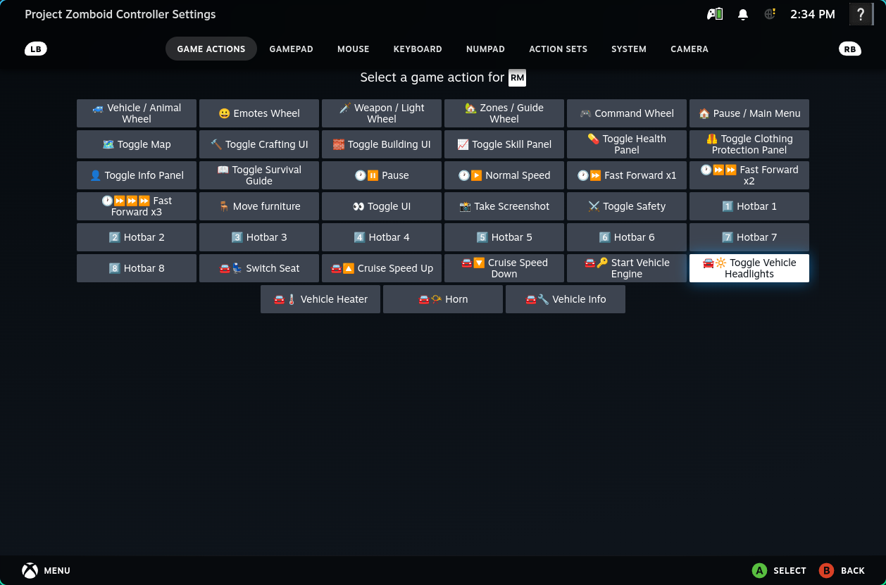
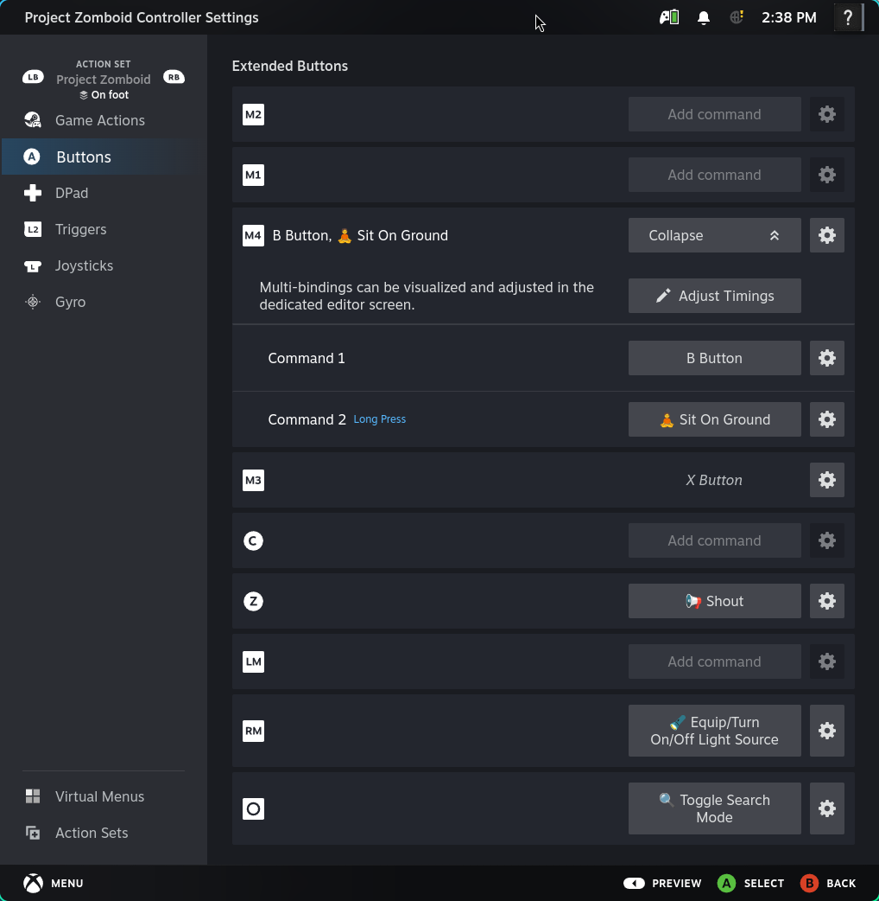
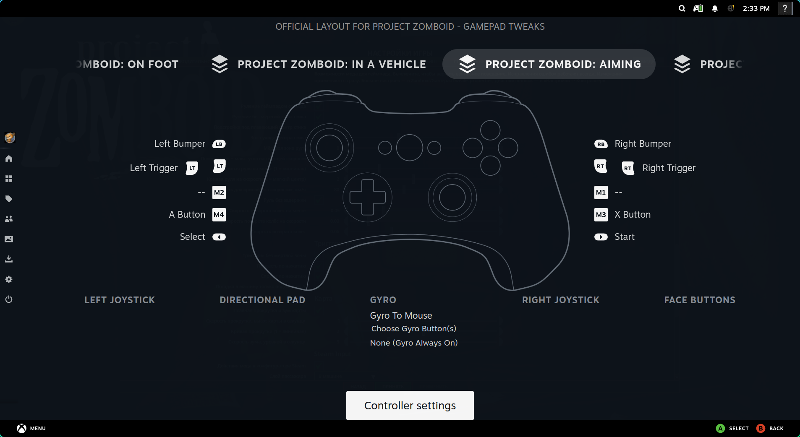
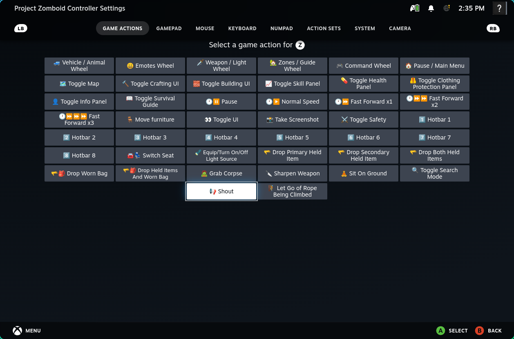
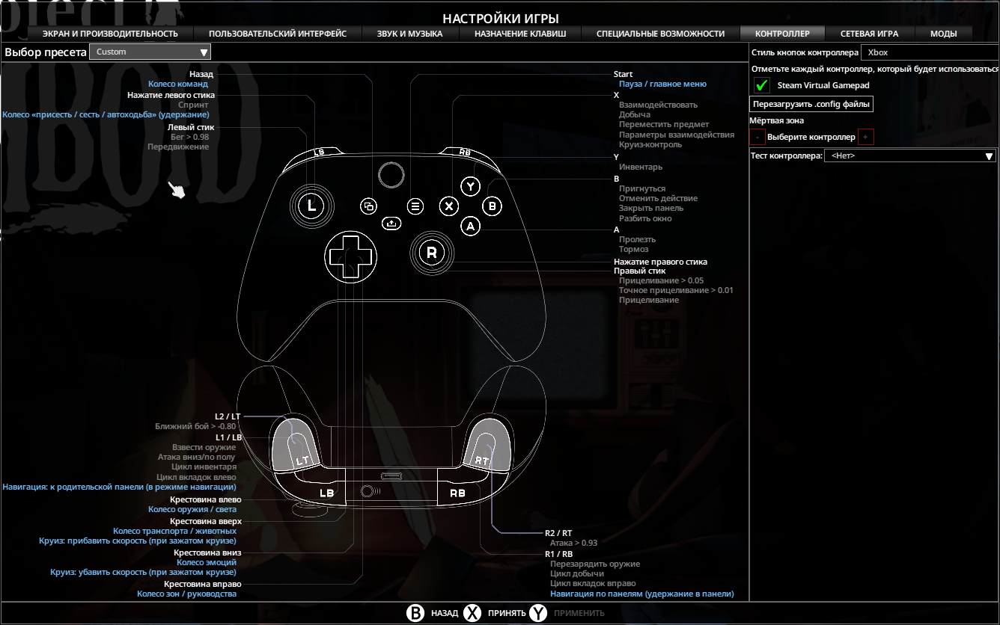
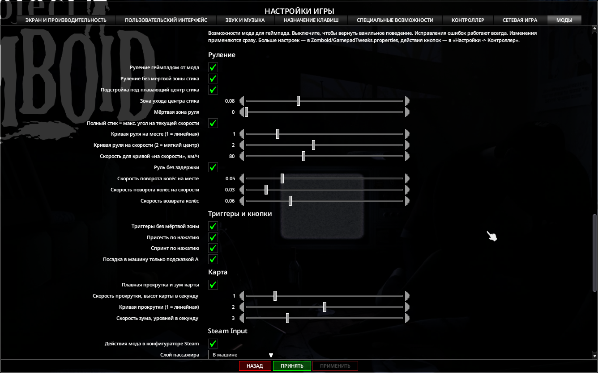
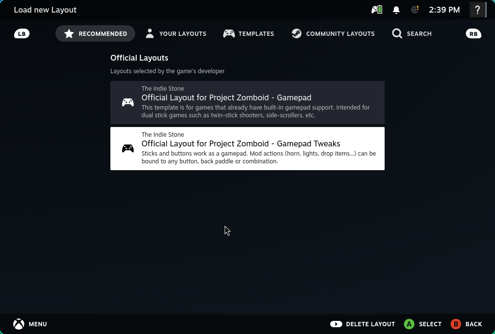

# Gamepad Tweaks

Java mod for Project Zomboid B42 (ZombieBuddy) that fixes gamepad handling.

## Features

- **Steering without dead zones.** In a vehicle the steering takes the raw stick X:
  - `Patches.SteeringInput`: `CarController.updateControls` uses the raw axis instead of
    `JoypadManager.getMovementAxisX` (no stick dead zone, no diagonal x1.41 stretch);
  - the wheel angle is computed by the mod (below), so the `Math.abs(steering) > 0.1F`
    dead zone in `CarController.update` no longer matters.

- **Drifting stick center** (`StickCenter`, applied to the raw X in `Patches.SteeringInput`).
  A released stick doesn't return to exactly 0: the spring leaves it a bit off, a different
  spot after every move (measured -0.01..-0.05 on a Vader 5 Pro, up to +-0.077 on a Vader 3).
  Without a dead zone that offset steers, and at highway speed even a 0.0003 wheel angle
  (stick -0.03) drives the car in a long arc, so the player has to hold the stick slightly
  off to go straight. A plain dead zone fixes it but kills fine steering. Instead the steering
  gets the distance from a learned center, rescaled so full deflection is still +-1, with no
  dead zone (`noiseDeadZone`, 0 by default):
  - while the stick stands still (range < `recenterStillRange` over `recenterStillMs`: the
    jitter zone, used only to detect that the stick stopped) within `recenterZone` of zero,
    the center glides to the mean of that window at `recenterRate` per second;
  - drift and a deliberate small hold look the same by position, so learning is armed only
    by a release: the stick was further than `releaseFrom` from the center and got back within
    `recenterZone` in less than `releaseMaxMs` (the direction isn't checked: without hardware
    smoothing the spring overshoots). Armed at start too;
  - moving the stick further than `disarmDistance` from where it rested (thumb steering)
    disarms it, except during `releaseSettleMs` after a release (overshoot swings).
  `steering.debugLog=true` logs arming/disarming and marks a locked center.

- **Speed-sensitive steering** (`Steering.shape`). Vanilla clamps the wheel angle at speed
  (`VehicleScript.getSteeringClamp`: 0.9 standing still, ~0.4 at max speed) but maps the
  stick 1:1, so at speed the outer stick travel does nothing and small deflections are too
  sharp. Instead:
  - response curve `|x|^exponent`, the exponent grows with speed (soft center at speed);
  - full stick = the clamp at the current speed.

- **Wheel without lag** (`Steering.wheel`, hooked into `CarController.update` by
  `SteeringHookTransformer`). Vanilla moves the wheel exponentially towards the stick, slower
  with speed (down to a ~3 s lag at top speed), and returns it quickly only when the stick is
  inside the 0.1 dead zone. Instead the wheel moves towards the stick at a constant rate,
  faster back to center. Only for gamepad drivers; keyboard steering stays vanilla.

- **Analog gas and brake** (`Throttle`, `Patches.Throttle*`, `throttle.*` settings). Vanilla
  `CarController.updateControls` makes the triggers on/off pedals (RT/LT > 0.7), and
  `control_ForwardNew` / `control_Reverse` / `control_Braking` push or brake with full force. Scaling
  the force by the pedal (as other mods do) only scales the acceleration: the game has almost no drag,
  so a light pedal still takes the car to top speed, slowly. Instead:
  - pedals count from the first bit of travel (`throttle.deadZone`), pedal = travel^`throttle.curve`;
  - resistance share `r = (speed / maxSpeed)^dragExponent`, engine force x `(pedal - r) / (1 - r)`:
    at a standstill the push = pedal, it fades with speed and is gone at `maxSpeed * pedal^(1/dragExponent)`,
    so every pedal position holds its own speed; full pedal = vanilla, traits / towing / offroad /
    MP speed limit stay on top; under the cruise control speed vanilla;
  - above that speed (`pedal < r`) the engine brakes, up to the vanilla released-pedal 10
    (x `throttle.engineBraking`), so easing off has no jolt;
  - a pedal against the motion (LT forward, RT rolling back) brakes from that up to the vehicle braking
    force by the pedal; B (x13), both pedals, unloaded chunk ahead stay vanilla;
  - RPM shown by the speed (`Patches.ThrottleRpm` on `CarController.update`): in vanilla the engine
    speed is a number of its own, not tied to the wheels. `control_ForwardNew` revs it at a fixed rate
    towards the gear change RPM on any pedal and shifts up once both the RPM and the speed reach the
    gear's top; released pedal / brake put the gearbox in N and the RPM falls to idle; no downshift in
    gear. The tachometer and the sound show it, so on a light pedal the engine revs while the car
    crawls. Vanilla keeps its number and does everything with it (force, shifts, N, released-pedal
    braking): the update runs with the vanilla RPM, and after it the engine shows an RPM from the speed
    across the current vanilla gear's band (idle or `afterGearChange` to `gearChange` at the gear's top
    speed), in proportion to the speed below and past the band (not below idle), never above vanilla's
    (on a full pedal vanilla's lags behind the speed: it shifts only once its own RPM reaches `gearChange`,
    a quick start outruns it and it then skips gears, 1 -> 3; that lag is shown as without the mod). In N the shown RPM falls by vanilla's steps from where it was (vanilla's is
    usually higher, it would jump up on release), down to vanilla's or idle. R, engine off: vanilla;
  - sound: the `VehicleLoad` parameter (vanilla 0/1, `isGasPedalPressed`) gets the smoothed share of
    the engine force (`ParameterVehicleLoad`, both the `audio` and `vehicleSound` ones);
  - off while Tsuki's AnalogThrottle is active (`ForeignThrottle`: its `ATBridge.enabled`; 0.1.3 runs
    only on 42.21). Both patch the same `CarController` methods: the force would be scaled twice and its
    RPM changes inside `update` would drive vanilla's shifts here.

- **Brake hold**, experimental, off by default (`Throttle.hold`, `throttle.brakeHold`, also with the vanilla on/off pedals). Vanilla
  `CarController.update` turns LT into a brake while the car moves forward and into reverse the moment it
  stops (`velocity . forward <= 0`), so a brake held a moment too long backs the car up, reverse beeper
  and all. Here LT that started braking (above 1 km/h) holds the car near the stop as the brake
  (`clientControls.brake`, as B) until it is released; the next press reverses. RT while backing up
  stays vanilla (brakes, then drives forward): after reversing the next move is almost always forward.

- **Triggers without dead zone** (`Triggers`, `Patches.*TriggerValue`). Vanilla
  `Joypad.getLTValue/getRTValue` apply the per-axis dead zone that the options screen
  dead zone buttons set for all axes at once (default 0.2 = first 10% of the travel).
  Triggers rest at zero and don't need it: the raw axis is used instead, the options
  screen shows no trigger dead zone, the buttons still work for the sticks.
  `triggers.debugLog=true` logs every raw value change.

- **UI presses don't leak to the character** (`ButtonLatch`). The UI reacts on press:
  B closes a menu, the focus goes away, the character's buttons are turned back on with
  B still held, and its release counts as a "click" (crouch toggle etc.). Buttons held
  when the character's buttons get turned on are ignored by the character until released.

- **Actions on press, not click** (`PressActions`). Vanilla toggles some gamepad actions on
  a "click" (release within 400 ms), so they lag and don't work with long-press binds:
  - crouch toggle: on press, unless the left stick radial menu is enabled;
  - toggle-to-sprint: on press;
  - enter/exit vehicle: vanilla also does it on an Interact click for any nearby vehicle,
    on top of the A prompt (on press); for the gamepad only the prompt is left.

- **Smooth map controls** (`MapControls.java`, called from the Lua override of
  `ISWorldMap:updateJoypad` / `ISMap:updateJoypad` in `media/lua/client/GamepadTweaks/MapControls.lua`).
  Vanilla treats the stick and triggers as buttons: stick below 0.5 per axis is ignored (on top
  of the game's dead zone), the map then waits 150 ms, the center snaps to whole squares (jumps
  at high zoom), isometric view drops diagonals; LT/RT (> 0.7) zoom one level per press, holding
  repeats only after the zoom animation ends; the paper map ignores the stick. Instead:
  - past the game's radial stick dead zone, pan speed = `map.panSpeed` map heights per second
    x deflection^`map.panExponent`, in screen directions (screen offset converted to world through
    the map projection, so isometric works too); D-pad = deflection `map.dpadDeflection`;
  - zoom speed = `map.zoomSpeed` levels per second x trigger^`map.zoomExponent` (RT in, LT out),
    `setZoom` around the map center, no step animation;
  - while rotating an annotation the stick keeps rotating it (no panning);
  - fliers and stash maps under the cross: vanilla `renderPrintMedia` / `renderStashMaps` pick the
    icon under the map center but then also require `isPointOver(getMouseX(), getMouseY())`, the real
    mouse cursor over the map (in splitscreen it is usually on another screen), so the icon never
    highlighted and A did nothing (streets have no such check). While they run in gamepad mode
    `isPointOver` tests the cross (Lua only, works without the jar);
  - without the jar (`GamepadTweaks_updateMap` missing) vanilla runs.

- **Fliers work with a controller** (`media/lua/client/GamepadTweaks/PrintMedia.lua`).
  Vanilla `ISReadABook:displayPrintMedia` calls `setJoypadFocus(playerNum, win)`, which evaluates
  `uiToString(win)` for a log line before assigning the focus; `ISAtomUIJoypad:toString` then does
  `self._ATOM_UI_CLASS.class:getSimpleName()`, which throws in Kahlua ("getSimpleName of non-table").
  The focus stays on the inventory: B/X/Y do nothing, the window closes only with Esc. Instead:
  `ISAtomUIJoypad.toString` that doesn't throw (Apply copies it into every PZAPI window); `close()`
  doesn't leave the focus on a hidden element; a B prompt in the bottom bar. Splitscreen issues
  of this window (shared `worldMapFlier`, `getPlayer()`) are fixed in SplitscreenFixes.

- **Rebindable hardcoded buttons** (`media/lua/client/GamepadTweaks/Bindings.lua`, values via
  `Settings` globals `GamepadTweaks_getSetting` / `GamepadTweaks_settingsVersion`).
  Vanilla handles these directly, past the binding system, so the buttons can't be used for
  anything else and the actions can't be moved:
  - D-pad wheels: `JoypadControllerData:onPressUp/...` -> `ISDPadWheels.onDisplayUp/Down/Left/Right`;
  - Back command wheel and Start pause: `onPressButtonNoFocus`;
  - cruise control speed: X + D-pad up/down (`ISVehicleRegulator.onJoypadPressUp/Down`);
  - L3 held -> crouch/sit/auto-walk radial (`ISJoystickButtonRadialMenu`, timer from
    `ISButtonPrompt:update`);
  - RB held in a UI -> panel navigation, LB in it -> parent panel (`onHoldButton`, `onReleaseButton`).

  The vanilla binding list is a Java enum (`CharacterJoypadButtonBinding`, fixed at class load and
  saved by name in `InputBindings/*.xml`), so it isn't extended; the actions live in the mod:
  `preset.<preset>.bind.<action>=<button>`, `none` frees the button for the regular bindings.
  Per vanilla preset (`getCore():getOptionGamepadBindingPreset()`), as the regular bindings are: the built-in
  Default and Original (Lua only, no `loadedSet`) always have the defaults, and the first change in them
  makes a new preset (vanilla `GameOptionControllerTab:onJoypadButtonBindingEdited`); a new preset copies
  the mod bindings of the one it's made from. The old global `bind.<action>` lines move to every saved preset. Actions are in layers
  (one button = one action per layer): `world` press (`vehicleWheel`, `emoteWheel`, `equipWheel`,
  `extraWheel`, `commandWheel`, `pause`), `cruise` press while driving with the CruiseControl
  button held, checked first (`cruiseFaster`, `cruiseSlower`, repeat while held), `hold`
  (`stickRadial`), `uiHold` (`uiNavigation`), `navigation` release (`uiNavigateParent`).
  Default = vanilla button, so nothing changes until rebound; an action set to a button takes it
  from the action that has it by default. A regular binding that acts in the world (not the UI-only
  ClosePanel/Cycle*/TransferItem) put on the button of a default world action takes it too: vanilla
  has none on the D-pad, Back or Start, so the player put it there (Melee on D-pad left no longer
  also opens the weapon wheel). Regular bindings are re-checked every 500 ms. Details:
  - the D-pad hooks are the `onDisplay*` calls made from `onPressUp/...` (so vanilla checks still
    apply: UI focus, drag); `ISVehicleRegulator.onJoypadPressUp/Down` return false there, the
    cruise layer is dispatched with the wheels. A world action fires once per press (vanilla D-pad
    repeats while held);
  - other buttons in the world: an action bound to them replaces vanilla (button prompts);
    a freed Back/Start does nothing;
  - wheels close on their vanilla button release (`hideWhenButtonReleased`), the mod switches it
    to the button that opened them; D-pad releases are also passed to the back button wheel;
  - without the jar the defaults are used.

- **Keyboard-only actions on the gamepad** (`media/lua/client/GamepadTweaks/KeyActions.lua`,
  registered with `Bindings.add`, world layer, unbound by default). Vanilla handles these keys in
  `OnKeyPressed` handlers that act for `getSpecificPlayer(0)` / `getPlayer()` (and some return for
  a controller player), so with a gamepad they are unavailable or only in a wheel. Each action does
  what the key handler does, for the controller's player (splitscreen-safe):
  - `lightSource`: `ItemBindingHandler.toggleLight` (off hand, main hand, attached, else equip the
    strongest light);
  - `dropPrimary`, `dropSecondary`, `dropBothHands`, `dropBag`, `dropHandsAndBag`:
    `CFarming_Interact.FastDropItem` (favorites are kept);
  - `grabCorpse`: `ISGrabCorpseAction.OnKeyPressed` / `PerformGrabCorpse` (let go, or grab the closest);
  - `sharpenWeapon`: `ISFirearmRadialMenu.sharpenWeapon` for the main hand item.
  - `firearmRadial`: the firearm radial (magazine, rounds, rack). Vanilla opens it only by
    holding the ReloadWeapon button (`ISFirearmRadialMenu.onRepeatRBumper`, 500 ms); this opens
    it at once and it picks / closes on the release of the action's button (`hides`: the
    radial's hardcoded RB is retargeted).
  - `sitOnGround`: `ISSitOnGround` key handler; `searchMode`: `ISSearchManager.handleKeyPressed`;
    `shout`: `Callout` (on foot / as a passenger, the driver has the horn); `releaseRope`: `fallFromRope`;
  - vehicle (`ISVehicleMenu.onKeyPressed/onKeyStartPressed`): `engine` (start / shut off),
    `headlights` (driver), `heater`, `horn` (driver, sounds while held: `release` callback on the
    button release), `switchSeat` (seat UI, in or next to a vehicle), `vehicleInfo` (mechanics).
  - extra (`category = "extra"`, for the settings panel): `map` (`ISWorldMap.ToggleWorldMap`),
    `craftingMenu`, `buildingMenu`, `moveFurniture` (as the back button wheel commands do),
    `skills`, `health`, `protection`, `info` (character window tab, `toggleView`, the controller gets
    the focus), `survivalGuide`, `hotbar1`..`hotbar8` (`ISHotbar:activateSlot`; vanilla hotbar keys
    work only for player 0 and not with a controller), `timePause`, `timeNormal`, `timeFast1..3`
    (`SpeedControlsHandler`, not in MP, `whilePaused`: run while paused, other buttons don't),
    `toggleUI`, `screenshot` (`Core.TakeFullScreenshot`, as `GameWindow` does for the key),
    `pvp` (`ISEquippedItem` safety toggle for the controller's player), `rotateBuilding` (the
    build cursor of the controller's player: `rotateKey`, as the ROTATE_BUILDING key; the 3D item
    placement spins while held, `ISPlace3DItemCursor.checkRotateJoypad` is wrapped), `voice`
    (push-to-talk, held: `Patches.VoiceHeld` makes `GameKeyboard.isKeyDown(ENABLE_VOICE_TRANSMIT)`,
    read by `VoiceManager`, true while held), `toggleMusic` (`SoundManager.allowMusic`, as
    `updateMusic` on TOGGLE_MUSIC) and `displayFps` (`FPSGraph`, as `IngameState` on DISPLAY_FPS),
    both in `KeyToggles.java`.
  - `panCamera` ("look far", held): vanilla pans a gamepad player's camera while aiming only with
    RB held (`PlayerCamera.update`, hardcoded, not in Options -> Controller), towards the aiming
    stick. `Patches.CameraRB` makes `JoypadManager.isRBPressed` false inside `PlayerCamera.update`,
    so the pan follows the action alone; it is on RB by default in the `aiming` layer of
    `Bindings.lua` (pressed while aiming or looking out of a vehicle, before the world layer;
    vanilla gives RB nothing else then: `getBestRBButtonAction`), and can be moved like any other.
    `CameraPan` (after `PlayerCamera.update`): while the action is held and the player aims
    (or looks out of a vehicle), the camera eases at vanilla's rate towards the reticle, so it
    follows the gyro too.
  - Shift variants and the context key. Interact (E) does more with Shift held, checked only on
    the keyboard (`CharacterInputComponent.isShiftKeyDown`), so a gamepad player can't do them:
    `drive` (Shift when getting in: the driver's seat through the nearest door,
    `ISVehicleMenu.processShiftEnter`, instead of the seat by that door; a passenger switches to
    it), `curtain` (Shift + E at a window / door / window frame: `IsoPlayer.doContextWindow` & co.;
    here the nearest curtain the player can reach, the one faced first,
    `ISWorldObjectContextMenu.onOpenCloseCurtain`), `fireMode` (Shift + Rack:
    `OnPressRackButton(player, gun, true)` cycles a select-fire gun). `useTool`: E while aiming
    with a tool works the square ahead (`CFarming_Interact.onContextKey`: chop, cut a bush, stump,
    ore, dig, sow, scythe, water, fertilize, cure, clean); the action does it without aiming.
    Vanilla runs that once per key press with a flag (`SawOnContextKeyEvent`) that only a keyboard
    Interact press resets, so with a gamepad it worked once per session; the mod wraps
    `onContextKey` to reset it per press of the Interact button for joypad players.
  - `animalRadial`: `AnimalContextMenu.showRadialMenu` (ANIMAL_RADIAL_MENU key, player 0 only in
    `ISUIHandler`); again closes it.

- **Mod actions in Options -> Controller** (`media/lua/client/GamepadTweaks/ControllerEditor.lua`).
  The vanilla editor rows (`CharacterJoypadBindingUIRow`) list and offer only the Java enum
  `CharacterJoypadButtonBinding`; the rows and their lists are Lua, so the vanilla functions run first
  and the mod adds its actions: in each button row the actions on that button (mod colour, with the
  context: cruise held, hold, ...), in the edit row a list per action (another action instead, or
  `< Remove >`), and in `< Add New >` the actions not on the button yet ("[Category] Name", by
  category). `Bindings.set` writes `preset.<preset>.bind.<id>` at once through `GamepadTweaks_setSetting` (Java:
  replaces the line or adds it after its `#` example, keeps the rest of the file); an action of the
  same layer on that button is set to `none`.
  Names: vanilla key binding names, mod strings in `media/lua/shared/Translate/{EN,RU}/UI.json`.

- **Mod actions as Steam Input game actions** (`SteamInput.java`, `Bindings.lua` Steam Input
  section, `media/steam_input/`). Vanilla doesn't use the Steam Input API: Steam only emulates a
  gamepad, so a Steam configuration can map buttons, keys and the mouse, but not the mod's
  actions, and extra buttons (back paddles) or Steam activators (long/double press, chords) can't
  reach them. The mod calls `ISteamInput::Init` and `SetInputActionManifestFilePath` (flat C API of
  the game's own `libsteam_api`, through the Foreign Function API) with `manifest.vdf`: one action
  set `game` with a button action per mod action (titles in English and Russian). In the Steam
  configurator they show up as game actions next to gamepad/keyboard/mouse bindings.
  - the manifest replaces the game's official layout in Steam's "Recommended" list, so it brings
    two per controller type, both with the set added (sticks, buttons and triggers stay the
    emulated gamepad until an action is bound): first Steam's plain "Gamepad" template under its
    own title (the default, as before), then the same bindings as "Gamepad Tweaks". Layout title tokens are looked up
    in the manifest's localization (not the layout's own), so the plain layout's title is there in
    every template language. Steam shows the
    game's developer as the author of both (`creator`, the mod author's SteamID64, is ignored so far); a layout can't
    point to a Steam template (paths are files next to the manifest), so the template is copied;
  - action set layers follow the player's situation (`Bindings.lua` picks them every frame,
    `GamepadTweaks_steamInputSetLayers`, Java activates them per Steam controller when they change),
    bottom to top: `onfoot` or `vehicle` (passengers: `steamInput.passengerLayer`), `aiming`, `ui`
    (a panel or radial has the joypad focus), `inventory` (the inventory or loot window), `map`; `menu` on every controller in the main menu and
    the pause menu. A layer overrides only what is bound in it, so one paddle can be the light on
    foot and the horn in a car, the gyro can be a mouse only in panels or only while aiming.
    Situational actions are declared in their layer (combat, movement, hands: `onfoot`; car:
    `vehicle`; close / tabs: `ui`; item moves: `inventory`), general ones in the set; a layer's
    actions fire only while it's active (leaving the car releases the horn);
  - Steam lists the set's actions and then the active layer's, in manifest order, with no
    groups, so titles are one or two short words that differ as whole words ("Brake", "Horn",
    "Take all") and start with an icon (color emoji; text-style symbols render small and
    monochrome unless followed by U+FE0F; hotbar slots get keycap numbers, since what a slot
    holds depends on the worn belt / back / webbing);
  - `GamepadTweaks_steamInputPoll` (Lua, every frame) reads the digital actions of every Steam
    controller and returns press/release edges; the controller is matched to the game's joypad by
    `GetGamepadIndexForController` and the "... pad N" joystick name, else the only joypad player;
  - a press runs the action as its button would (in the world, also with a UI focused; while
    paused only actions that work then); a wheel closes and picks the slice on release;
  - `steamInput.enabled=false` turns it off (restart), `steamInput.debugLog=true` logs events;
  - the files are generated by `tools/steam_input.py` from `tools/steam_actions.txt` (section =
    the set or a layer, order, icon, English / Russian title, revision; its header says how to
    edit it), checked against the Lua action lists, and the local Steam templates. A new action
    in the Lua code has to be added there, the script names the missing ones.

- **Inventory and loot window actions** (`InventoryActions.lua`, layer `inventory` in
  `Bindings.lua`). With a mouse the buttons above the item list are one click (Transfer All /
  Loot All, same type, same type to nearby containers, Move to Floor:
  `ISInventoryWindowContainerControls`, `ISLootWindowContainerControls` handlers), Drop is a drag
  to the floor, a double click equips / wears / eats (`ISInventoryPane:doContextualDblClick`).
  With a gamepad it's A -> context menu -> scroll, and most of the handlers add nothing to the
  gamepad menu (`handleJoypadContextMenu` is empty except Remove All and the appliance toggles), so
  same type, nearby containers and Move to Floor can't be done at all; Drop and Unpack are mouse-only
  menu options (`getJoypadBind() == -1`). The mod adds actions for the focused window and its
  selected row (header = the stack, item row = that item, as vanilla X): `invTransferAll`,
  `invTransferSameType`, `invTransferSameTypeNearby`, `invAllToFloor` (loot: the Move to Floor
  button; inventory: the shown bag / main inventory with the `ISInventoryPane:transferAll` filter,
  so worn, equipped, hotbar, favorite items and key rings stay), `invDropSelected`,
  `invTransferStack` / `invTransferOne` (X for the whole stack / one item whatever the row: e.g.
  Steam: X on a tap, `invTransferStack` on a long press), `invUse`, `invUnpack`. They call the
  vanilla handlers / context menu functions. Unbound by default; a bound button runs the action
  instead of what vanilla does with it in the window (`ISInventoryPage:onJoypadDown`,
  `onJoypadDir*` wrapped). Not done: selecting several rows. In joypad mode
  `ISInventoryPane` clears the selection every frame, so vanilla works with one row only.

- **Vanilla bindings as Steam actions** (`VanillaActions.lua`, `HeldActions.java`). Steam lists
  only the mod's game actions, so a player looking for "Crouch" in the configurator doesn't find
  it, and vanilla ties each binding to its physical button. Each vanilla button binding is also a
  Steam action `vanilla<Binding>` (first in the list) that runs the game function behind it
  directly, as the keyboard does; no button is pressed, so nothing else on any button fires, and
  it works whether the binding is on a button, shares one, or has none:
  - character (Java `CharacterInputComponent` consumers): Crouch -> `setSneaking` (as
    `IsoPlayer.updateSneakKey`), Rack -> `OnPressRackButton` (`IsoPlayer.checkReloading`),
    Reload -> `OnPressReloadButton` (it only stops loading rounds) and
    `ISReloadWeaponAction.BeginAutomaticReload` (the gamepad reload is the RB prompt of
    `ISFirearmRadialMenu`, timed on the release hardcoded to RB), Zoom -> `Core.doZoomScroll` (`UIManager.handleZoomKeys`);
  - held: Sprint, Manual Floor Attack, Brakes, the Java half of Interact, Aim, Attack, Melee and
    Run set a held state per controller that the game's query also returns (`isSprintButtonDown`,
    `isManualFloorAtkButtonDown`, `isInteractButtonDownInternal`: doors, windows, grapple via
    `IsoPlayer.updateUseKey` -> `doContext`; `isAimKeyDownInternal` and
    `isPrecisionAimKeyDownInternal`, `isAttackButtonDown`, `isMeleeButtonDownInternal`,
    `isRunButtonDown`; the brake in `CarController.updateControls`), so toggle-to-sprint and the
    rest of vanilla still apply. On a gamepad vanilla takes Aim from the right stick (turn, the
    reticle at a fixed distance), Precision Aim from a half-pressed RT (the free firearm reticle),
    Attack from RT past 0.93, Melee from LT, Run from the movement stick past 0.975. The Aim action
    is the keyboard Aim key: both aims, no stick needed (gyro aiming), so Precision Aim has no
    action. Attack needs aiming, as with the mouse;
  - button prompts: `ISButtonPrompt:setButtonBindingPrompt` is wrapped to keep each binding's
    handler by name (vanilla keeps one per button, the last evaluated); Interact, Cancel, Climb
    Through, Smash Window run it. Interact Options and Inventory are evaluated by vanilla only for
    the button they're on (`getBestXButtonAction` / `getBestYButtonAction`), so they are evaluated
    on the press, the button slots restored after. With a build cursor Interact / Cancel go to it
    (`drag:onJoypadPressButton` A / B, hardcoded in vanilla);
  - panels: Close Panel, Cycle Tabs, Transfer Item, Cycle Inventory / Loot are in the editor but
    no code reads them (panels take hardcoded buttons); the action gives the focused panel that
    command (`onJoypadDown(B)`, LB/RB), the inventory window directly (close = Y, containers,
    `doGrabOnJoypadSelected`);
  - Cruise Control: on / off on the press (`ISVehicleRegulator.onJoypadReleaseX` toggles on the
    release, because the held button + D-pad sets the speed; the action has the separate
    cruise faster / slower actions). With no speed set yet it takes the current one.
  Left out: Walk To (needs a cursor), Loot (unused), Precision Aim (in Aim). Not in the in-game
  editor, which already has them (`steamOnly`).

- **Gyro / trackpad aiming** (`AnalogInput.java`, `SteamInput.Analog`, Steam analog action `aim`,
  `absolute_mouse`). The gamepad reticle (`AimingReticle`) aims at the screen center + half screen *
  stick (`getAimingScreenX/Y`), then `AimingMode.lerpAiming` moves it there: eased in precise
  firearm aim, only the direction at a fixed distance in melee / plain aim. Steam's mouse deltas
  (gyro, trackpad; Steam does activation, sensitivity, smoothing) are an offset per player added to
  that target (`Patches.AimTargetX/Y`), kept on the player's screen and dropped when aiming ends, so
  the gyro starts from the stick (or from the player with the stick released). In precise aim the
  reticle itself is moved by the same delta too (`aimingPositions`), so vanilla's easing (meant for
  the stick) doesn't lag the gyro. Steam is read right before `AimingReticle.update` (`Mouse.update`,
  `SteamInput.updateAnalog`), after `SteamAPI_RunCallbacks` ran Steam's frame. `aim` is declared
  in the `aiming` layer (only there it means anything), so the gyro is bound there. With the held
  Aim action, the stick isn't needed at all.
  Aiming without the Aim binding (half RT, PrecisionAim, stick released) snaps the reticle in front of
  the player (`AimingMode.shouldSnapAimInFrontOfPlayer`: no stick, nothing to aim with). The first gyro
  delta then takes the reticle from where it stands (offset = reticle - stick target) and the player
  counts as aimed until aiming ends (`AnalogInput.gyroAiming`, `Patches.GyroAimNoSnap`); modes that
  always snap (melee, unarmed: `fixedAtMinDistance`, `minDistanceAmount == -1`) still do.
  Steering and movement analog actions (`steer` in the `vehicle` layer, `move` in `onfoot`,
  `joystick_move`) are added to the steering stick (`Patches.SteeringInput`, before the mod's
  shaping) and to the Movement axis binding (`Patches.MoveX/Y`, `MoveApplied`; Run at full
  deflection sees it via `Patches.MoveAxisDown`). They are meant for a stick or trackpad, not the
  gyro: Steam drops gyro-to-joystick output after any action set layer change until the game
  window loses and regains focus.
  Layers are switched by difference (`DeactivateActionSetLayer` / `ActivateActionSetLayer` of the
  changed ones only).

- **Controller vibration** (`Rumble.java`, `media/lua/client/GamepadTweaks/Rumble.lua`, `rumble.*`
  settings). Vanilla has no vibration at all: input goes through GLFW, which can't drive the
  motors. Steam Input can, for every controller Steam handles: `SteamInput.vibrate` calls
  `ISteamInput::TriggerVibrationExtended` (big and small motor, right trigger motor on Xbox
  One / Series pads), so it needs `steamInput.enabled` and the game started from Steam.
  Lua picks the events and sends pulses (start at full, fade out linearly), Java mixes them per
  controller (strongest value per motor) and sends the speeds every frame from `pollEvents`:
  - shot: `OnWeaponSwingHitPoint` with a ranged weapon that isn't dry firing
    (`isRangedWeaponEmpty`), stronger and longer with the gun's sound radius (pistol < rifle < shotgun);
  - melee hit: `OnWeaponHitCharacter`, by damage;
  - getting hurt: health lost in one tick (bites, falls, car crashes, fire; bleeding and hunger
    stay under the threshold);
  - heartbeat: double beat while panicked (panic moodle 2+), faster and stronger with the level;
  - thunder: `OnThunderEvent` comes with the flash, the pulse follows with the sound
    (`dist / 300` s, as `ThunderStorm.enqueueThunderEvent`), a crack for a strike, a long roll for
    rumble, by distance, half indoors;
  - body (`RumbleEvents.update`): the player's action states (`media/actiongroups/player`) are
    watched every frame: `collide` (sprinting into a wall), `bumped`, `knockeddown`, `falldown`,
    landing (leaving `falling`, `climbfence`, `climbwall`, `climbwindow`), `hitreaction*` (also
    hits stopped by clothing);
  - burns: `OnPlayerGetDamage` `FIRE` (vanilla shows no reaction, and each step is too small for
    the health check), uneven bursts while burning;
  - window opening: `IsoWindow.ToggleWindow`, when it actually opens or closes (a stuck window
    only on the try that works), not when the action starts;
  - tools: weapon on a door / window / barricade (`OnWeaponHitThumpable`) by damage, axe in a tree
    (`OnWeaponHitTree` and `ISChopTreeAction` `ChopTree`, also on an MP client), prying boards
    (`ISUnbarricadeAction`: creaks while it goes, a pop when it comes off), forcing a lock with
    a crowbar (`ISForceOpen`: each `ForceOpenAttempt`, success);
  - vehicle (`VehicleRumble`, every controller player in it): the grip motors carry the vehicle
    by side (left wheels front and rear = left grip, right = right grip), impacts panned by where
    they come from with some on both grips. Trigger motors (Xbox One / Series, Steam's
    `TriggerVibrationExtended`) differ in frequency and power from the grips, so they don't
    stand for front vs rear: they add a short accent to knocks at the front (front wheel knocks,
    impacts and bodies ahead), never the surface texture (`rumble.triggers`,
    `rumble.triggerGain`). Steam drives trigger motors only on pads it sees as Xbox One
    (`GetInputTypeForHandle` = 3); on others the accent goes to the grip of that side. Crash
    (`BaseVehicle.crash`, before damage, so also without injuries) by impact, from the velocity
    change (`lastLinearVelocity` vs
    `jniLinearVelocity` in the body's axes); running someone over
    (`playSoundVehicleHitCharacter`) by speed, where the body is; zombies banging on the vehicle
    or its window (their `ZombieThumpVehicle(Window)` sound in `CharacterSoundEmitter.playSound`
    with the vehicle as proxy), where the zombie is;
  - suspension: per wheel `wheelInfo.suspensionLength` against the script's rest length and
    travel; a quick compression or drop is a knock on that wheel's side, reaching the end of
    the travel a hard hit; a body under a wheel (`testCollisionWithProneCharacter` per-wheel
    impulse) a knock on its side;
  - road surface per wheel (floor sprite, as `ParameterVehicleRoadMaterial`, plus plowed land
    `vegetation_farming_*`): a knock on the wheel that leaves or gets back on the asphalt, and
    each wheel's side gets the texture of its own surface (grips only); speed makes it stronger and denser
    (grain intervals are for 40 km/h, scaled by 40 / speed within x0.4..x3): grass soft swells,
    dirt road uneven with ruts, gravel a fine fast crunch, sand long smooth waves, snow barely,
    furrows and railway sleepers a beat per 0.7 / 0.65 tiles driven. It fades to a third over
    continuous off-road time (a long dirt road stays bearable) and comes back after 10 s on
    asphalt;
  - motor test (Options -> Mods button, `GamepadTweaks_rumbleTest`): each motor alone in turn,
    left grip, right grip, left trigger, right trigger, to see which is where on a given pad;
  - glass breaking within 3 tiles (`IsoWindow.smashWindow`) and zombies banging on doors, windows
    and barricades within 4 tiles (`IsoGameCharacter.setTimeThumping`, bumped once per thump by
    `ThumpState.execute`), weaker further away;
  - jump scare: the "ZombieSurprisedPlayer" sting of `IsoPlayer.updateLOS` (caught in
    `CharacterSoundEmitter.playSoundImpl`), a hard kick, by the game's jump scare volume (0 = none).
  Each event has its own strength (`rumble.<event>`), plus `rumble.strength`; also in
  Options -> Mods.

- **Brakes follow their binding** (`HeldActions.brake`, after `CarController.updateControls`).
  Vanilla brakes a gamepad driver's car on B (`JoypadManager.isBPressed`), past the Brakes binding;
  now it is the binding (B by default), plus the Steam action. The forced brake stays.

- **Cruise control and reload follow their bindings** (`Bindings.lua`). Vanilla puts the prompts of
  `CruiseControl` and `ReloadWeapon` on their bound buttons but hardcodes the rest: the cruise
  toggle happens on X release (`onReleaseButton` -> `ISVehicleRegulator.onJoypadReleaseX`), the
  speed changes with X held; the firearm radial opens while RB is held (`ISButtonPrompt:update` ->
  `ISFirearmRadialMenu.onRepeatRBumper`), quick reload and closing the radial are on RB release.
  With either binding moved (e.g. CruiseControl on RB) they don't work. Also the cruise prompt
  (its press handler) is set only while JoyPadSetup evaluates the X button, and the evaluation of
  the CruiseControl button right after clears it (RB: `getBestRBButtonAction`, no firearm); the mod
  sets it again after every `ISButtonPrompt:getBestButtonBindingAction`. Here all of it uses the
  bound button; on the vanilla buttons nothing changes.
  The cruise layer is dispatched before vanilla `onPressUp/...`, so mods wrapping `onDisplayUp`
  (Smart Radial Menu opens its menu when the vehicle radial stays empty) don't see those presses.

Settings live in `~/Zomboid/GamepadTweaks.properties` (created with defaults on first
launch, re-read while the game runs).

- **Options -> Mods -> Gamepad Tweaks** (`media/lua/client/GamepadTweaks/Options.lua`,
  `PZAPI.ModOptions`). Not every player wants the features (steering without a dead zone etc.)
  or the default tuning for their controller, and the file is hard to find. The page shows the
  features and the values worth tuning; it is a view of the `.properties` file, not of
  `ModOptions.ini`: the values are read from the file whenever vanilla loads the mod options
  (`PZAPI.ModOptions:load`, wrapped; `MainOptions` calls it when it builds the Mods page), and
  Apply writes back only the changed ones (`GamepadTweaks_setSetting`), so hand-set values outside
  a slider's range survive. Dependent options are greyed out while their feature is off.
  Feature switches (all on by default, off = vanilla):
  - `steering.enabled`: all of the steering changes (`Patches.SteeringInput`, `Steering.wheel`);
  - `steering.rawStick`: raw stick X and `StickCenter`; off = the game's stick value, still shaped
    by `Steering.shape`; `steering.recenter`: center learning;
  - `steering.constantRateWheel`: `Steering.wheel` (off = vanilla wheel lag);
  - `steering.scaleToSpeedClamp`: full stick = the clamp;
  - `triggers.noDeadZone`: `Triggers.value` / `Triggers.deadZone`;
  - `actions.crouchOnPress`, `actions.sprintOnPress`, `actions.vehicleOnlyByPrompt`: `PressActions`;
  - `map.smooth`: `MapControls.update` returns false, Lua runs vanilla;
  - `steamInput.enabled` (restart), `steamInput.passengerLayer`.
  Sliders: steering dead zone, center drift zone, curve exponents and their speed, wheel rates,
  map pan speed / curve, zoom speed. Fixes (`ButtonLatch`, fliers, cruise/reload bindings) have
  no switch; debug logs and the center learning timings are file-only.

Stick axis indices and inversion come from `~/Zomboid/joypads/<guid>.config`
(`MovementAxisX`, `MovementAxisXFlipped`): the game loads them into `JoypadManager.Joypad`.

## Screenshots

`screenshots/` (also the Workshop gallery, see Publishing):

| | |
|---|---|
|  |  |
|  |  |
|  |  |
|  | |

## Layout

```
src/main/java/dev/gamepadtweaks/   mod source
Contents/mods/GamepadTweaks/       the mod itself (Workshop layout; the game loads it from ~/Zomboid/Workshop)
  42/mod.info
  42/poster.png                    mod list poster (512x512)
  42/media/java/client/GamepadTweaks.jar   <- build.sh output
build.sh                           build
preview.png                        Workshop preview (256x256 or 512x512, <= 1 MB)
screenshots/                       Workshop gallery images (uploaded by hand, not by the game)
workshop.txt                       Workshop title, description (BBCode), tags, visibility
tools/decompile.sh                 decompile game classes into decompiled/ (not in git)
```

## Build

Requires JDK 25 (game classes are Java 25):

```sh
sudo pacman -S jdk25-openjdk
./build.sh
```

The jar is built against the installed game. When `~/Zomboid/tools/pz-versions.sh` is there,
the build also keeps the installed `projectzomboid.jar` in `~/Zomboid/jars/<version>/` and
compiles against every kept version (stable and beta branch); "does NOT compile against game X"
means the mod would break in X. After a test run, `~/Zomboid/tools/checklog.py GamepadTweaks`
summarizes `console.txt` (mod loads per save, errors, Steam Input per session).

## Source

https://github.com/fu11zero/gamepad-tweaks

## Publishing

Build first (the jar is not in git), then in the game: main menu -> Workshop -> upload,
pick GamepadTweaks. The game uploads only `Contents/` plus `preview.png` and checks
(`SteamWorkshopItem.validateContents`): preview present and square 256/512 px, no
`*.sh *.so *.dll *.exe *.zip ...` inside `Contents/`, a `mod.info` with `id=` in a version
folder. Allowed tags: `media/WorkshopTags.txt` in the game folder. After the first upload the
game writes the item id into `workshop.txt`.

The game uploads only `preview.png` as the item image (`SteamWorkshopItem` -> `SetItemPreview`).
The gallery (`screenshots/`, in file name order) is added on the item's Steam page: "Add/edit images
& videos" (owner only). The description's "Screenshots" list follows the same order.

## Reading game code

```sh
tools/decompile.sh zombie/core/physics/CarController zombie/input/JoypadManager
```

## Requirements

- ZombieBuddy 2.3.4+ installed as a Java agent (`-javaagent:ZombieBuddy.jar --` in launch options).
- On first launch ZombieBuddy asks to approve the new jar; it asks again after every rebuild.
